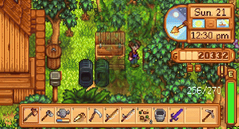
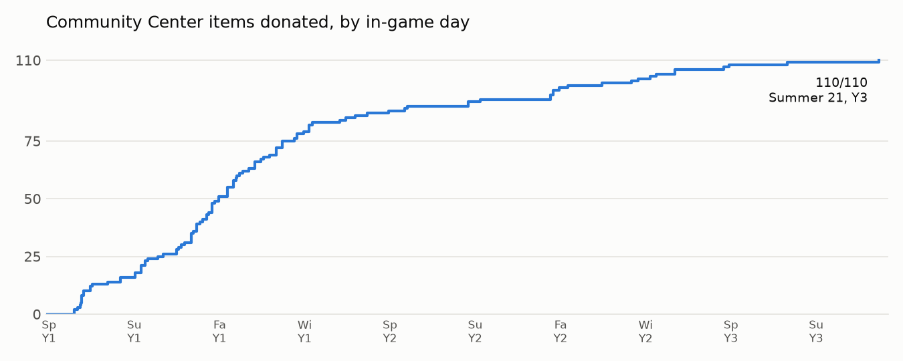
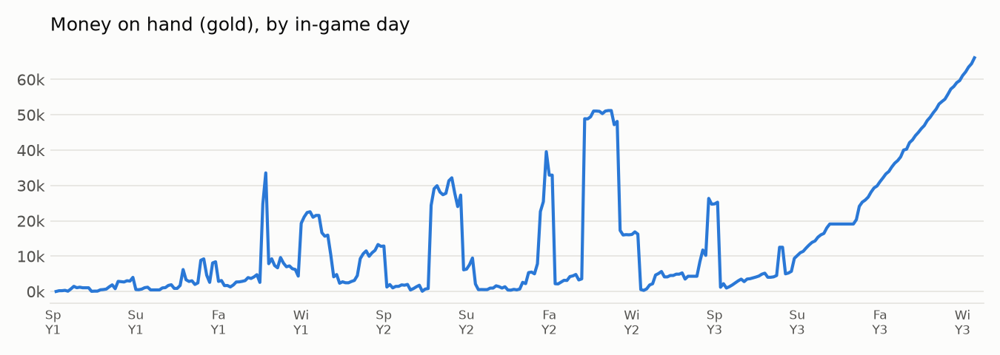
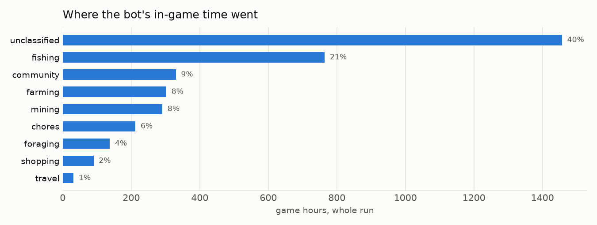
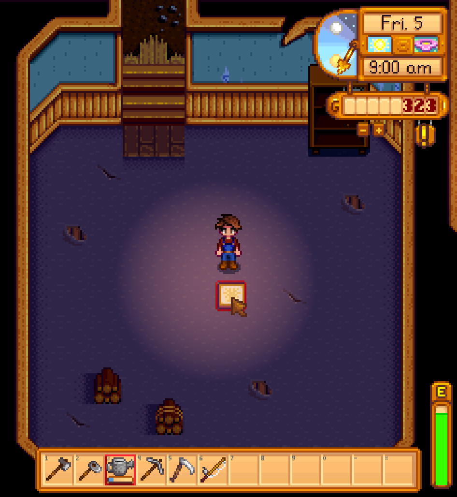
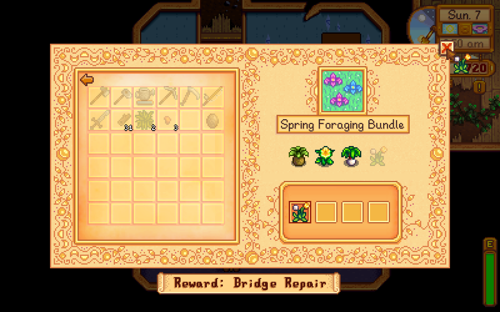

# stardew-cc-bot

A bot that plays Stardew Valley through a virtual controller and works toward completing the
Community Center. It uses no cheats, no item spawning and no save editing. It walks, uses tools,
fishes, mines, farms, raises animals and shops the way a player does.

It was built over one week with Claude (Anthropic's AI): Claude wrote the code, played the game
through it, and fixed it after each in-game day. The run below is the result of that process.

> **Status: experimental.** The bot completed the Community Center once, but with daily code fixes
> along the way. A fresh save is not yet guaranteed to finish without help. It will get stuck sometimes.
> See [Status](#status).

## The run

- Community Center: **30/30 bundles on Summer 21, Year 3** (about day 272), on a Standard farm, single player, game 1.6.15.
- Order of the last items: Maki Roll (cooked), Quartz and Fire Quartz (mines), Large Egg, Truffle and
  Duck Feather (Traveling Cart), Rabbit's Foot (own rabbit).
- 154 blind spots found and fixed along the way: [LESSONS.md](LESSONS.md) (what went wrong, root cause, fix).
- Per-day stats: [results/day_summary.csv](results/day_summary.csv) (game minutes per activity), [results/RUNLOG.csv](results/RUNLOG.csv).

For comparison: the speedrun record is Spring 15, Year 1 (a team using seed control), and a solo chosen-seed run
finished in the first summer. Good human players with a normal random seed report late Fall Year 1 to Spring Year 2.

### Proof

The last item (Rabbit's Foot, from its own rabbit) going into the Enchanter's Bundle on Summer 21, Year 3,
from the bot's own timelapse recording (slowed down):



**[Highlights video (62 s)](media/highlights.mp4)**: clips from the daily timelapses, from day 1 to the last bundle.
Each day was recorded at 1 frame per 2 seconds of real time while the bot played at fast-forward.

<picture>
  <source media="(prefers-color-scheme: dark)" srcset="media/cc_progress_dark.png">
  
</picture>

Fast through Year 1 (79 of 110 items by Winter 1, 87 by the end of Year 1), then a long tail: the last items needed Year 2 crops,
a pig for the Truffle, coop upgrades and lucky Traveling Cart stock.

<picture>
  <source media="(prefers-color-scheme: dark)" srcset="media/money_dark.png">
  
</picture>

Each drop is a building or animal purchase (Coop, Barn, upgrades, the 16,000g pig) or a Vault payment.
After the Community Center was done the bot kept playing about 70 days by mistake (the auto-stop bug, now fixed),
which is the climb at the end.

<picture>
  <source media="(prefers-color-scheme: dark)" srcset="media/time_dark.png">
  
</picture>

Game time between log lines, grouped by what the bot was doing. "Unclassified" is time after log lines that
don't match an activity keyword (mostly walking between tasks and waiting), so treat the split as rough.

| | |
|---|---|
|  |  |
| Spring 5, Year 1: first visit to the Community Center | Spring 7, Year 1: first donation |

Raw data:
- [results/logs/](results/logs/): full bot logs of a few days, including the last-bundle day (`y3_summer_21.log`, donation at 13:20).
- [results/cc_final_state.json](results/cc_final_state.json): bundle state read from the game at the end.
  (The four Vault bundles show `complete: false` there because buying them only sets the first flag in the game's data;
  the game still counts them as done. See `agent/cc_progress.py`.)
- [results/day_summary.csv](results/day_summary.csv), [results/RUNLOG.csv](results/RUNLOG.csv): per-day stats.
- [Release v0.1](https://github.com/md-amer/stardew-cc-bot/releases/tag/v0.1): all 309 day logs and the final save file
  (Winter 4, Year 3), which you can load in your own game.

## How it works

```
Stardew Valley + SMAPI
  └─ mod/ClaudeHands (C#)       HTTP JSON API on 127.0.0.1:8775
       VirtualInput   virtual keyboard + mouse, merged into the game's own input read
       Walker         A* pathing over the game's collision check, walks by holding keys
       StateReader    what the player can see: map, objects, inventory, clock (no luck value, no RNG)
       MenuReader     clickable widgets of the open menu, so the agent clicks by name
       FastForward    runs the whole game update N times per frame (fair speed-up)
       NoAchievements blocks Steam/GOG achievement unlocks
agent/ (Python, standard library only, no network, no AI at runtime)
  play_day.py   one full day: chores, shopping, bundles, fishing, mining, sleep
  farming / animals / mining / town / cook / cart / donate / fishplan / seasons ...
sim/ (Python)   planning simulator: Monte Carlo over weather, luck, cart and animal rolls
```

The bot plays only its own isolated save: farmer and farm must both be named "Claude" and the save folder `Claude_*`.
It runs the game with its own config folder and Mods folder, so your saves and mods are never touched.
The title screen's Load and Co-op buttons are blocked for the bot.

## Install (Linux)

Requirements: Stardew Valley 1.6 (Steam or GOG), [SMAPI](https://smapi.io) 4.x, .NET SDK 6 or newer, Python 3.10+, curl.

```bash
git clone https://github.com/md-amer/stardew-cc-bot
cd stardew-cc-bot
./install.sh                 # finds the game, builds the mod into ./env/Mods, installs `stardew-cc`
stardew-cc                   # first run creates a fresh farm, then plays day after day
stardew-cc stop              # stop after the current in-game day
```

If the game is not found, set `STARDEW_PATH=/path/to/Stardew Valley/game`.
Options: `SPEED=4 stardew-cc` (fast-forward factor, default 8), `RECORD=1` (daily timelapse video, needs ffmpeg).
Logs: `logs/<day>.log`. Live stats dashboard: `stats/tui.py` (needs `textual`).

Windows and macOS are not supported yet (the scripts are bash, and the game launch is Linux-only).

## Status

What works: the full day loop, all six rooms' item sources (crops, forage, fishing, mining, animals,
cooking, Traveling Cart, Desert), season deadlines, money planning, auto-stop when the Community Center is complete.

What does not yet work reliably:
- A full fresh-save run to completion has not been done yet. The run above started from a save that was being
  fixed as it went. On a brand-new farm the bot now crafts its own storage chest, buys and plants the bundle
  seeds, forages, chops, mines and donates (first Construction items on Spring 6-8 in testing), but only the
  first ~10 days have been tested.
- Recovery from rare stuck states (the launcher restarts the game from the last save, up to 5 times).
- Speed. A human finishes much earlier. The planning simulator (below) estimates the bot could reach
  a median of Year 2 Fall 1 with the best plan, versus Year 3 Summer 21 in the real run.

Contributions that fix stuck states are welcome: each log line is timestamped with the in-game time.

## Planning simulator (`sim/`)

A day-level model of the game (crops, animals, fishing odds copied from the game's fish-pick code, mines,
cart, fruit bats, travel times from the maps) with a nightly rolling planner. Results over 1,000 random seeds
([sim/RESULTS.md](sim/RESULTS.md), numbers and sources in [sim/NUMBERS.md](sim/NUMBERS.md)):

| Player speed | Best plan, median | 90th percentile |
|---|---|---|
| Bot | Year 2 Fall 1 (day 168) | Year 2 Winter 20 |
| Human | Year 1 Winter 14 (day 97) | Year 2 Summer 10 |

Findings: money is the binding constraint in Year 1; build Coop → Big Coop → Apple sapling → Deluxe Coop before the Barn;
buy a pig for the Truffle; choose fruit bats; fishing is limited by season and weather windows, not by time.

The simulator needs data extracted from your own copy of the game (not included): build and run
`sim/tools/datadump` and `sim/tools/mapdump` with `-p:GamePath=/path/to/game`.

## Fair play

- Single player only. Achievements are blocked. Do not use it on a save you care about or to claim records.
- No game files, decompiled code or game data are included in this repository. You need your own copy of the game.
- Stardew Valley is a trademark of ConcernedApe. This project is not affiliated with or endorsed by ConcernedApe.

## License

MIT, see [LICENSE](LICENSE).
